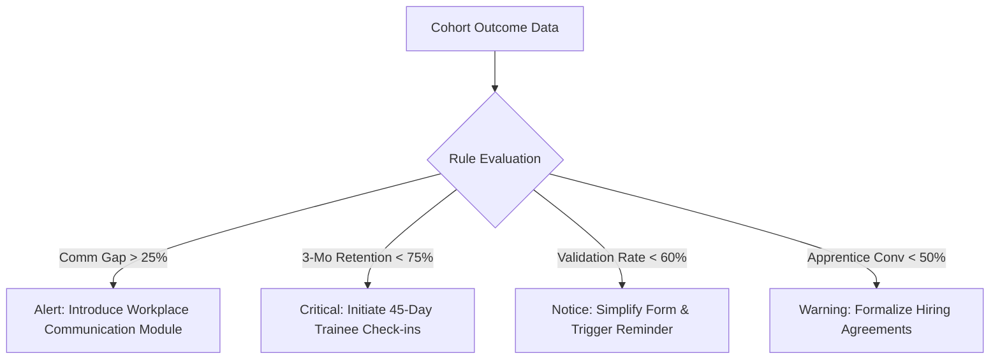

# Trainee Longitudinal Outcome Tracking System
## Core Focus, Real-World Problems & Implemented Solutions

---

## 1. Executive Overview & Core Focus

The **Trainee Longitudinal Outcome Tracking System** is a privacy-conscious, low-burden web platform built on the MERN stack (MongoDB, Express, React, Node.js). 

While traditional vocational and educational tracking platforms only measure **course completion** and **initial placement**, they lack a reliable mechanism to follow what happens to graduates in the months and years following training. 

This platform shifts the paradigm from **short-term placement counts** to **longitudinal employment impact, wage progression, and verified retention**.

```
┌─────────────────────────┐     ┌─────────────────────────┐     ┌─────────────────────────┐
│   Traditional System    │     │      Core Shift         │     │ Longitudinal Tracking   │
│                         │     │                         │     │                         │
│ • Initial Placement     │ ──► │ Continuous Verification │ ──► │ • 30/90/180-Day Surveys │
│ • Static Spreadsheets   │     │ Privacy-by-Design       │     │ • Wage Band Progression │
│ • No Skill-Gap Feedback │     │ Actionable Analytics    │     │ • Employer Validation   │
└─────────────────────────┘     └─────────────────────────┘     └─────────────────────────┘
```

---

## 2. Problem vs. Solution Matrix

Below is a detailed mapping of the real-world operational problems faced by training providers and how this system solves each issue:

| # | Real-World Problem | Root Cause | System Solution Implemented |
|---|---|---|---|
| **1** | **Trainees become unreachable after graduation** | Phone numbers change, spreadsheets rot, and manual follow-ups are inconsistent. | **Automated Longitudinal Scheduler**: Automatically provisions scheduled **30-, 90-, and 180-day micro-surveys** triggered the moment course completion is recorded. |
| **2** | **"Ghost Placements" & Early Churn** | Placements are counted even if a trainee never starts or leaves after 2 weeks. | **3-Month & 6-Month Retention Tracking**: Dedicated 90-day and 180-day checkpoints measure retention against placed cohorts. |
| **3** | **Unverified & Stale Wage Information** | Salary data is self-reported, rarely updated, and often inaccurate. | **Preserved History Snapshots & Wage Bands**: Standardized brackets (`$40k-$60k`, `$60k-$80k`, etc.) track salary jumps over time without overwriting previous states. |
| **4** | **Underrepresented Non-Traditional Outcomes** | Self-employment, freelance work, and apprenticeships are often lost or miscategorized. | **Multi-Outcome Architecture**: Native tracking for 7 categories: *Employed*, *Self-Employed*, *Apprentice*, *Seeking Work*, *Further Education*, *Unavailable*, and *Other*. |
| **5** | **Fragmented / Unavailable Employer Feedback** | Employers rarely respond to complex institutional survey requests. | **Frictionless Token-Based Validation (`/validation/:token`)**: Employers click a secure, time-limited link without needing a portal account to verify employment in < 60 seconds. |
| **6** | **Survey Fatigue & Low Response Rates** | Long, burdensome questionnaires cause high drop-off rates. | **Conditional Micro-Surveys**: 2-minute forms with dynamic branching (non-employed trainees skip irrelevant salary/employer questions). |
| **7** | **Privacy & Compliance Concerns** | Collecting exact personal salaries and contact details creates legal risks (GDPR, FERPA). | **Privacy-by-Design & Consent (v1.0)**: Explicit purpose-specific consent, instant withdrawal capability, and minimal privacy data exposure. |
| **8** | **Data Without Actionable Insights** | Administrators collect data but lack clear steps to improve training. | **Section 22 Actionable Rule Engine**: Automated alerts that convert statistical patterns (e.g. *Communication Gap > 25%*) into concrete curriculum recommendations. |

---

## 3. Deep-Dive: Key Architectural Solutions

### 3.1. Immutable History Snapshots (Section 14 Data Model Rule)
- **The Pitfall**: Traditional databases update trainee documents directly (`user.salary = $70,000`), overwriting previous earnings and losing career progression data.
- **The Solution**: Every status change creates an immutable `EmploymentRecord` snapshot linked to the trainee.
- **Result**: The system reconstructs career trajectories (e.g., *March: Apprentice at $30k* ➔ *June: Full-time at $50k* ➔ *December: Promoted to $70k*).

### 3.2. Secure, Zero-Friction Employer Validation (Section 20)
- **The Pitfall**: Forcing employers to register accounts causes immediate drop-off and low validation rates.
- **The Solution**: 
  1. The training provider clicks **"Request Validation"**.
  2. The system generates a cryptographic, time-limited validation token.
  3. The employer opens `/validation/:token`, views only minimal identification details, confirms the role/wage band with one click, and selects skill gaps from a standardized menu.

### 3.3. Section 22 Actionable Analytics & Rule Engine
Rather than presenting passive numbers, the analytics engine evaluates KPIs against transparent operational rules:



### 3.4. Role-Based Access Control (RBAC)
- **Trainee**: Views personal records, manages consent, reports milestones, and submits micro-surveys.
- **Training Provider**: Manages cohorts, tracks completions, generates validation tokens, and monitors survey queues.
- **Employer**: Verifies graduate employment and submits structured skill-gap tags.
- **System Admin**: Controls user permissions, monitors security audit logs, analyzes system-wide metrics, and exports data.

---

## 4. Summary of Project Deliverables

- **Frontend**: Full React 18 + Tailwind CSS application with responsive dashboards for all 4 roles.
- **Backend API**: Modular Node.js / Express REST API with JWT authentication and RBAC middleware.
- **Database**: MongoDB/Mongoose with automatic in-memory fallback for zero-setup execution.
- **Data Seeding**: Built-in 1-click synthetic demo dataset covering 3 programs, 5 cohorts, and 10+ realistic trainee journeys.
